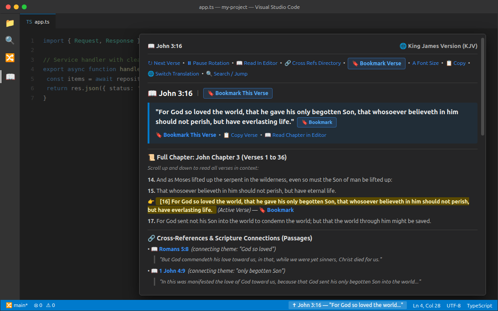
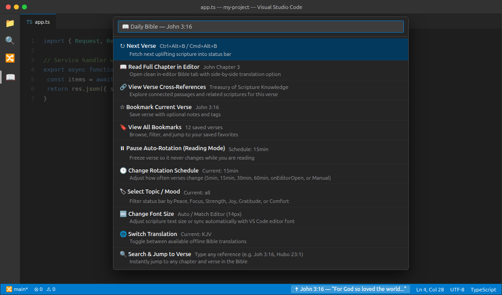

# Daily Bible — Offline & Scripture Status Bar 📖

> **"Nginamandla ukwenza konke ngaye ongiqinisayo." — KwabaseFilipi 4:13**  
> *"I can do all things through Christ who strengthens me." — Philippians 4:13*

**Daily Bible** is a fast, 100% offline, privacy-first VS Code extension designed to bring encouraging Holy Scripture directly into your coding environment. Glance at inspiring verses in your status bar while in the flow of programming, or launch the immersive in-editor Bible reader with parallel translations, chapter navigation, and bookmarking.

### 📸 Preview

**Scrollable Hover Reader (Active Verse, Bookmarking, Full Chapter & Cross-References)**  

**Quick Action Options Menu (`Ctrl+Alt+B` / Click Status Bar)**  

---

## ✨ Core Philosophy

1. **100% Offline-First Core & Zero-Login**: **English (KJV)** and **isiZulu (1959)** are bundled locally with zero network calls, zero telemetry, and no accounts required.
2. **Searchable In-Editor Translation Library (59+ Versions)**: Browse, search, and download additional translations on demand (WEB, Berean Standard Bible, Spanish, Portuguese, French, Chinese, Swahili, Shona, German, Hindi, Arabic, Russian, Korean, and more) — downloaded once (~1.2 MB each) and stored locally for permanent offline use.
3. **From Glanceable to Immersive**: Subtle status bar scripture that rotates gently throughout your workday, expanding to a full dual-view reader when you want to dive deep.

---

## 🚀 Key Features

### 1. 🌍 Multilingual Offline Scripture & Searchable Library
- **Default Offline Bundled**: **King James Version (KJV)** and **isiZulu (*IBhayibheli Elingcwele 1959*)** with authentic Zulu book names (`USenesisi`, `AmaHubo`, `Hubo`, `UMathewu`, `KwabaseFilipi`, `IsAmbulo`).
- **57+ Downloadable Offline Translations**: Including **WEB**, **BSB**, **ASV**, **Swahili**, **Shona**, **Chichewa**, **Yorùbá**, **Hausa**, **Spanish**, **Portuguese**, **French**, **Chinese (Simplified & Traditional)**, **German**, **Italian**, **Russian**, **Hindi**, **Arabic**, **Hebrew**, **Korean**, and more.
- **In-Editor Translation Switcher**: Search by language, version name, or region, and download or switch Primary & Parallel translations in one click.

### 2. ✝ Glanceable Status Bar Integration
- Rotating scripture with customizable prefix icon: `✝` (cross), `📖` (book), `🕊️` (dove), or none.
- Three display formatting modes:
  - `compact`: Reference only (e.g. `✝ Psalm 23:1` or `✝ AmaHubo 23:1`).
  - `preview`: Reference + snippet (e.g. `✝ Phil 4:13 — "I can do all things..."`).
  - `full`: Complete verse text directly in the status bar.
- Interactive Markdown hover card with one-click actions:
  - `[🔄 Next Verse]` • `[📖 Open Full Chapter]` • `[🔗 Cross Refs]` • `[⭐ Bookmark]` • `[📋 Copy]`
  - Direct clickable links to related **Cross References** from the *Treasury of Scripture Knowledge*.
  - Real-time parallel translation preview in hover card if enabled.

### 3. 🔗 Comprehensive Scripture Cross-References (TSK)
- Integrated 100% offline dataset from the classic **Treasury of Scripture Knowledge (TSK)** covering 63,000+ cross-reference entries.
- **In the Reader**: Each verse with connected passages displays a `🔗` button. Clicking it expands an interactive tray of anchor phrases and reference pills (e.g. `[Rom 5:8]`, `[1 John 4:9]`). Clicking any pill jumps directly to that passage in the Bible reader.
- **In the Status Bar Menu**: Command `Daily Bible: View Verse Cross-References` (`dailyBread.showCrossReferences`) surfaces a searchable QuickPick of all connected verses for instant jumping.

### 4. 📖 In-Editor Bible Reader (Read-Only)
- Command `dailyBread.openReader` (or `dailyBread.readChapter`) opens a clean, beautifully styled in-editor tab:
  - Clean typography, high-contrast verse numbers, and active theme synchronization.
  - Interactive top navigation: `[◀ Prev Chapter]`, book & chapter selector dropdown, `[Next Chapter ▶]`.
  - **Parallel / Dual View Option**: Read isiZulu and English side-by-side in parallel columns!
  - Click or hover any individual verse to bookmark or copy.
  - Auto-scroll & highlight when jumping directly to a verse.

### 4. ⭐ Bookmarks & Favorites System
- Stored permanently in VS Code `globalState` (persists across sessions and workspaces).
- Attach custom personal notes and `#tags` to any bookmark.
- Interactive QuickPick menu (`dailyBread.showBookmarks`) to browse, filter, and jump.
- Export all your saved favorites to **Markdown (`.md`)** or **JSON (`.json`)**.

### 5. 📚 Dedicated Activity Bar "Bible Explorer"
Adds a dedicated Holy Bible icon to the VS Code Activity Bar with three collapsible views:
1. **Books & Chapters**: Browse Genesis to Revelation (USenesisi kuya kuIsAmbulo) grouped by Old and New Testament with 1-click chapter reading.
2. **My Bookmarks & Favorites**: List of your bookmarked verses with inline notes, quick jump, and delete actions.
3. **Curated Topics & Moods**: Quick folders organized by theme (Peace, Focus & Wisdom, Strength, Hard Times, Gratitude, Joy).

### 6. ⏱️ Smart Rotation Schedules & Triggers
- Automatic rotation timer: `manual`, `5min`, `15min` (default), `30min`, `60min`.
- `onEditorOpen`: Rotates to a fresh verse whenever you switch or open an editor tab.
- `rotateOnFileSave`: Encouraging scripture refresh whenever you save your code.

---

## ⌨️ Keyboard Shortcuts & Commands

| Command | Shortcut | Description |
| :--- | :--- | :--- |
| `dailyBread.nextVerse` | `Ctrl+Alt+B` / `Cmd+Alt+B` | Advance to next rotating verse |
| `dailyBread.menu` | Click on status bar | Open primary scripture action menu |
| `dailyBread.readChapter` | — | Read full chapter of current verse in editor |
| `dailyBread.openReader` | — | Launch in-editor Bible reader |
| `dailyBread.jumpTo` | — | Search & jump to any verse (e.g. `Joh 3:16`, `Hubo 23:1`) |
| `dailyBread.bookmarkCurrent`| — | Bookmark current status bar verse |
| `dailyBread.showBookmarks` | — | View and filter saved favorites |
| `dailyBread.selectTopic` | — | Choose active scripture theme / mood |
| `dailyBread.switchTranslation` | — | Open searchable in-editor translation library & offline downloader |
| `dailyBread.copyVerse` | — | Copy current verse and citation to clipboard |
| `dailyBread.exportBookmarks` | — | Export bookmarks to Markdown or JSON |
| `dailyBread.randomChapter` | — | Open a random chapter from scripture |

---

## ⚙️ Configuration Settings

Configure via VS Code Settings (`Ctrl+,` or `Cmd+,`, search for `dailyBread`):

| Setting | Default | Options | Description |
| :--- | :--- | :--- | :--- |
| `dailyBread.translation` | `"kjv"` | `"kjv"`, `"zulu"`, or any downloaded translation ID | Primary translation (Default offline: KJV & isiZulu; download 57+ more via Switch Translation) |
| `dailyBread.dualTranslation`| `"none"` | `"none"`, `"zulu"`, `"kjv"`, or any downloaded ID | Secondary parallel translation in reader & hover |
| `dailyBread.displayMode` | `"preview"` | `"compact"`, `"preview"`, `"full"` | Status bar layout format |
| `dailyBread.icon` | `"cross"` | `"cross"`, `"book"`, `"dove"`, `"none"` | Status bar icon prefix |
| `dailyBread.rotationSchedule` | `"15min"` | `"manual"`, `"5min"`, `"15min"`, `"30min"`, `"60min"`, `"onEditorOpen"` | Timer frequency for rotating scripture |
| `dailyBread.rotateOnFileSave` | `false` | `true`, `false` | Rotate scripture on saving files |
| `dailyBread.preventRotationWhileReading` | `true` | `true`, `false` | Prevents status bar scripture from changing while reading hover card or reader |
| `dailyBread.topic` | `"all"` | `"all"`, `"peace"`, `"wisdom"`, `"strength"`, `"comfort"`, `"gratitude"`, `"joy"` | Filter rotation by topic / mood |

---

## 🔍 Smart Verse Search Examples

The search bar (`dailyBread.jumpTo`) supports both English and isiZulu book names, prefixes, and common abbreviations:

- `AmaHubo 23:1` or `Hubo 23:1` or `Psalm 23:1`
- `UMathewu 6:33` or `Mathewu 6:33` or `Matt 6:33`
- `Joh 3:16` or `UJohane 3:16`
- `KwabaseFilipi 4:13` or `Phil 4:13`
- `USenesisi 1:1` or `Gen 1:1`
- `IsAmbulo 21:4` or `Rev 21:4`

---

## 🛡️ Privacy & Offline Guarantee

Daily Bible runs **100% locally on your machine** with **no telemetry and no tracking**. **English (KJV)** and **isiZulu (1959)** are packaged directly inside the extension bundle for zero-internet startup. Network access is **only** used when you explicitly click **Download** inside the in-editor Translation Library to fetch an optional language pack (saved locally for permanent offline use).

---

## 📜 License

MIT License. Bundled and downloadable Holy Bible texts are Public Domain or Openly Licensed (Creative Commons / Biblica Open) as noted per translation in the in-editor Translation Library.

